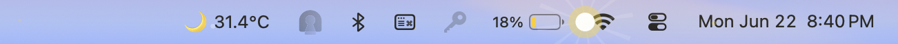
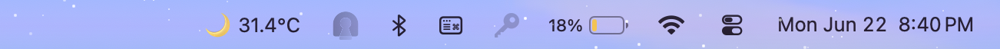
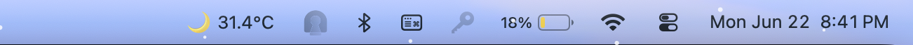
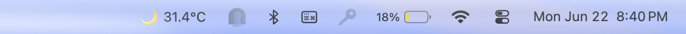

# Weather Menu Bar Overlay

[](https://www.apple.com/macos/)
[](https://swift.org)
[](https://developer.apple.com/xcode/swiftui/)
[](LICENSE)
[](https://open-meteo.com/)
[](#-performance--battery-optimization)
[](#-development)
[](https://github.com/rajanchavda/weather-widget/stargazers)
[](https://github.com/rajanchavda/weather-widget/issues)
[](https://github.com/rajanchavda/weather-widget/commits/main)

A beautiful macOS menu bar weather application that displays real-time weather conditions with atmospheric visual effects, twinkling stars on clear nights, and a temperature forecast graph.

## 📸 Screenshots

**☀️ Sunny**


**🌙 Night**


**❄️ Snowy**


**🌫️ Foggy**


## ✨ Features

- **Real-time Weather**: Fetches current weather and 12-hour forecast from Open-Meteo API
- **Automatic Location**: IP-based geolocation by default — no permission prompt, no setup
- **Saved Locations**: Save any number of cities worldwide and switch between them from the **Locations** submenu
- **Atmospheric Aurora**: Weather-responsive gradient overlays on the menu bar
- **Realistic Animated Weather Effects**:
  - 🌧️ **Rain** - Cinematic 3-layer depth raindrops with wind drift, blue water tint, and ripple splashes
  - 💧 **Drizzle** - A few slow, short drops with a wider sway
  - ⛈️ **Thunderstorm** - Heavy slanted rainfall with dramatic lightning flashes every 6 seconds
  - ❄️ **Snow** - Gentle snowfall with slow drifting flakes
  - ☀️ **Clear Day** - Sun with rotating rays and a drifting lens flare
  - ☁️ **Cloudy / Fog** - Drifting clouds, or soft fog wisps across the top of the bar
  - ⭐ **Clear Night** - High-density twinkling stars with an occasional shooting star
- **Day/Night Icons**: Sun ☀️ during day, Moon 🌙 at night
- **Temperature Forecast Line**: Optional graph showing 12-hour temperature trend at the bottom of menu bar
- **Temperature Units**: Switch between Celsius and Fahrenheit
- **Menu Bar Layouts**: Icon + Temperature, Icon Only or Temperature Only, with an optional Air Quality Index (European AQI) readout
- **Weather Alerts**: A notification when a thunderstorm, rain, freezing rain, snow, fog or freezing temperatures first appear in the next two hours of the forecast
- **Brightness Control**: 4 levels (25%, 50%, 75%, 100%)
- **Eco Mode**: Freezes the animations and dims the overlay; switches on by itself on battery at 20% or below
- **Multi-monitor**: One overlay per screen that shows a menu bar
- **Auto-refresh**: Updates weather every 5 minutes
- **Low Battery Impact**: Optimized for minimal energy consumption

## 📦 Installation

### Option 1: Install via Homebrew (Recommended)

**Install:**
```bash
brew install rajanchavda/tap/weatheroverlay
```

**Upgrade:**
```bash
brew upgrade rajanchavda/tap/weatheroverlay
```

> **Signing status:** release builds are currently **ad-hoc signed and not notarized** by Apple. So that macOS will open the app, the Homebrew cask clears the quarantine attribute after install (`xattr -cr`). That step goes away once releases are notarized — see [Releasing & Signing](#releasing--signing).

### Option 2: Build from Source

1. **Clone the repository:**
   ```bash
   git clone https://github.com/rajanchavda/weather-widget.git
   cd weather-widget
   ```

2. **Build the app:**
   ```bash
   swift build -c release
   ```

3. **Run the app:**
   ```bash
   .build/release/WeatherOverlay
   ```

4. **Optional: Build an app bundle and copy it to Applications:**
   ```bash
   # Builds WeatherOverlay.app (ad-hoc signed) and WeatherOverlay.zip in the repository root.
   # The argument is the version written into the bundle (1.0.0 when omitted).
   ./build_app.sh 2.4.1
   cp -R WeatherOverlay.app /Applications/
   ```

5. **Launch at Login (Optional):**
   - Turn on **Settings → Launch at Login** in the app's menu (the app bundle should be in your Applications folder)
   - Or go to System Settings → General → Login Items, click "+" and add WeatherOverlay

### Option 3: Open in Xcode

1. Open the package folder in Xcode (Xcode reads `Package.swift` directly, no project file is needed):
   ```bash
   xed .
   ```

2. Select the `WeatherOverlay` scheme

3. Build and run (⌘R)

### Uninstallation

If you installed via Homebrew, you can remove the app by running:
```bash
brew uninstall weatheroverlay
```

To completely remove the app along with its saved preferences (`~/Library/Preferences/com.weatheroverlay.WeatherOverlay.plist`):
```bash
brew uninstall --zap weatheroverlay
```

## 🎮 Usage

The app runs as a menu bar item (no Dock icon). Click the weather icon to open the menu:

- **Location / Condition** - Two read-only rows at the top: the current city, and the temperature with a short description (e.g. "Condition: 18.4°C • Partly Cloudy")
- **Locations** 📍
  - **Auto (IP-based)** - Detect the city from your public IP (default)
  - *Your saved cities* - Click one to switch to it; the active one is ticked
  - **Add Location...** - Search for a city by name (e.g. "Mumbai", "London", "New York") and save it. It becomes the active location and **persists across launches** — the app stays on that city until you pick another one.
  - **Remove Location...** - Pick a saved city to delete
- **Appearance**
  - **Atmospheric Aurora** ✓ - Toggle weather-responsive visual effects (enabled by default)
  - **Brightness** - Adjust overlay brightness (100%, 75%, 50%, 25%)
  - **Try Different Aurora** 🎨 - Preview all aurora styles without waiting for weather changes. Hover a style to preview it live, click it to keep it:
    - Auto (Weather-based) - Default mode
    - Clear Day - Sunny orange/yellow gradient
    - Clear Night - Night sky with twinkling stars
    - Cloudy - Gray/blue overcast
    - Foggy - Misty white/gray
    - Rainy - Blue/purple rain
    - Snowy - White/cyan frost
    - Thunderstorm - Dark purple storm

    Rain drops and lightning are drawn while a style is hovered. Once a style is selected they appear only when the current hour really has precipitation.
- **Menu Bar Layout**
  - **Icon + Temperature / Icon Only / Temperature Only** - What the menu bar item shows
  - **Show Air Quality Index** ☐ - Append the European AQI value and category to the menu bar item (disabled by default)
  - **Bottom Forecast Line** ☐ - Show/hide 12-hour temperature graph (disabled by default)
- **Settings**
  - **Temperature Unit** - Choose Celsius (°C) or Fahrenheit (°F)
  - **Weather Alerts** ✓ - Notifications for weather approaching in the next two hours (enabled by default)
  - **Eco Mode** ☐ - Freeze the animations and dim the overlay to at most 50% brightness. Switches on by itself on battery at 20% or below; a 🌱 appears in the menu bar while it is on
  - **Launch at Login** ☐ - Start the app when you log in
- **Reset to Defaults** - Restore all settings to original state (saved locations are kept)
- **Force Refresh Weather** (⌘R) - Manual weather update
- **Check for Updates** - Look for a newer GitHub release. If there is one, the app asks before running `brew upgrade` and restarting. The item reads "Update Available (vX)..." when the check at launch has already found one
- **About Weather Overlay** - Shows the installed version
- **Quit Weather Overlay** (⌘Q)

## 📍 Location & Refresh Behavior

The app offers two location modes — **Auto (IP-based)** and **Saved locations (cities you add)**. No location permission prompt is ever shown.

### Auto (default)
- City is detected from your public IP via FreeIPAPI (with ipapi.co as a fallback).
- The result is **kept in memory for one hour** instead of being looked up on every refresh. It is looked up again sooner after a network change (Wi-Fi switch, VPN toggle), after the app resumes from sleep, display sleep or a user switch, and on **Force Refresh Weather** (⌘R). If you're roaming or behind a different VPN, the city updates after one of these, or within the hour at the latest.
- If both lookup services fail, the last known location is used instead of failing the refresh.
- Accuracy: typically city-level (good enough for general weather glances).

### Saved locations
- Open **Locations → Add Location...** and type a city name. If Open-Meteo's free geocoding API finds several places, pick one of the top five (e.g. "Paris, Île-de-France, France" or "Paris, Texas, United States"). The city you add becomes the active location.
- While a saved city is active it is **locked** and never changes on its own. Every refresh — auto, screen unlock, system wake, or ⌘R — uses the same coordinates, and no IP lookup is made.
- You can save several cities and switch between them by clicking one in **Locations**.
- Saved cities and the active choice **persist across app launches** (stored in `UserDefaults`).
- To go back to IP-based detection, click **Locations → Auto (IP-based)**. To delete a city, use **Locations → Remove Location...** (removing the active city also returns to Auto).
- A city pinned with an older, single-location version of the app is carried over as a saved location on first launch.
- *Note:* "Reset to Defaults" does NOT change your saved locations or the active one.

### Refresh cadence
- **Auto-refresh**: every **5 minutes** (300 seconds)
- **Force refresh**: ⌘R from the menu
- **System events**: refresh fires automatically on screen unlock, system wake, display wake, switching back to your user session, and when the network connection comes back
- **Paused while asleep**: refreshing stops and the overlay is removed while the Mac or the display sleeps, or another user session is active
- **Network timeout**: 15 seconds per request. If a refresh fails, the last good weather stays on screen and the menu shows when it was last updated; after 3 hours without a successful refresh an error is shown instead

### Why no GPS / device location?
The app intentionally uses IP-based geolocation rather than CoreLocation/GPS so it can be distributed without code-signing complications, permission prompts, or first-launch friction. For users who want precision, a saved city gives pin-point accuracy with zero permission UX.

## 🌈 Aurora Visual Modes & Animations

The aurora background automatically changes color based on real-time weather conditions (WMO weather codes):

| Weather Type | Aurora Colors | Icon (Day) | Icon (Night) | Animated Effects |
|--------------|---------------|------------|--------------|------------------|
| **Clear** | Orange/Yellow (day)<br>Indigo/Purple (night) | ☀️ | 🌙 | ☀️ Sun with rotating rays and lens flare by day<br>⭐ Twinkling stars at night<br>Mainly clear adds two faint clouds |
| **Cloudy** | Gray/Blue | ☁️ | ☁️ | ⛅ Partly cloudy: sun or stars behind a few clouds<br>☁️ Overcast: more, grayer clouds |
| **Fog** | Warm White/Gray (day)<br>Dark Blue (night) | 🌫️ | 🌫️ | 🌫️ Drifting fog wisps |
| **Drizzle** | Blue/Purple | 🌧️ | 🌧️ | 💧 Sparse, slow drizzle (5 drops) |
| **Rain / Freezing Rain** | Blue/Purple | 🌧️ | 🌧️ | 💧 Light 3-layer rain (10 drops) with wind & ripples |
| **Snow** | White/Cyan | ❄️ | ❄️ | ❄️ Light (18 flakes), moderate (35) or heavy (60) snowfall |
| **Showers** | Blue/Purple | 🌦️ | 🌦️ | 💧 Medium 3-layer rainfall (25 drops) |
| **Snow Showers** | White/Cyan | 🌨️ | 🌨️ | ❄️ Light (18 flakes) or heavy (60) snowfall |
| **Thunderstorm** | Dark Purple | ⛈️ | ⛈️ | ⚡ Heavy slanted rain (40 drops) + lightning flashes |

**Precipitation gate**: all rain animations, including the thunderstorm's lightning, are drawn only while the forecast reports more than 0 mm of precipitation for the current hour. The aurora colors and the menu bar icon follow the weather code alone.

**Night Detection**: taken from the day/night flag (`is_day`) that Open-Meteo returns for the location. Only when no weather data is available does the app fall back to the clock: 8 PM - 6 AM (20:00 - 06:00).

### Animation Details
- **Rain**: 5-40 drops depending on intensity (drizzle 5, rain 10, showers 25, thunderstorm 40) with cinematic features:
  - **3-layer depth system** (near/mid/far) with parallax speed
  - **Variable physics**: roughly 4-14px drop length (2-10px for drizzle), depth-based opacity (0.71-0.89)
  - **Wind drift**: Continuous ±3px horizontal sway (±5px for drizzle)
  - **Blue water tint**: Natural rain color (not white)
  - **Advanced splashes**: Ripple with an expanding ring and a rebounding droplet, plus side splatter for the nearest drops
- **Drizzle**: Falls more slowly than rain, with shorter drops
- **Thunderstorm Lightning**: Full-screen white flashes every 6 seconds (0.15s duration, 25% opacity)
- **Snow**: 18-60 snowflakes depending on intensity (light 18, moderate 35, heavy 60) in three depth layers with wind drift and sine-wave flutter, over a frost line at the bottom edge. Heavier snow falls faster, drifts further in the wind and leaves a thicker frost line
- **Sun**: 12 slowly rotating rays, a pulsing halo, a drifting lens flare and floating dust motes
- **Clouds**: 2 faint clouds when mainly clear, 3 when partly cloudy (with the sun or stars still showing), 6 grayer ones when overcast; dim and cool-tinted at night
- **Fog**: 8 blurred wisps drifting across the top half of the bar
- **Weather changes**: the aurora colors and effects crossfade over 1.5 seconds, and rain and snow start with a few particles and build to full strength over about 4 seconds
- **Stars**: 4x density compared to typical apps (one star per 25px of width), deterministic twinkling patterns (roughly 3.4-12.6s cycles), and a shooting star every 15 seconds

## 📊 Temperature Forecast Line (How It Works)

When enabled (**Menu Bar Layout → Bottom Forecast Line**), a sleek temperature line graph appears at the bottom of your menu bar:

- **Data**: Shows next 12 hours of temperature forecast
- **Position**: Bottom 6 pixels of menu bar (1-5px from bottom edge)
- **Style**: 2.5px gradient stroke with rounded caps and shadow
- **Y-axis**: Normalized to temperature range (high temps at top, low at bottom)
- **X-axis**: Evenly distributed across full screen width
- **Update**: Refreshes every 5 minutes with new weather data

**Color Gradient** (temperature-based):
- < 0°C: Deep Cyan (freezing)
- 0-15°C: Cool Blue
- 15-22°C: Mild Green/Teal
- 22-30°C: Warm Gold/Yellow
- \> 30°C: Hot Red/Orange

This gives you a quick visual glance at whether temperatures are rising, falling, or staying steady throughout the day.

## ⚡ Performance & Battery Optimization

### Refresh Interval
- **Auto-refresh**: Every **5 minutes** (300 seconds)
- **Manual refresh**: Available via menu (⌘R)
- **Network timeout**: 15 seconds per API request

### Battery Consumption
**Estimated Impact**: ~0.5-2% per hour (very low, varies by weather)

**Real-World Measurements**:
- **Clear/Cloudy** (no animations): ~0.3-0.5% per hour
- **Light Rain/Snow**: ~0.8-1.2% per hour
- **Thunderstorm** (heavy rain + lightning): ~1.5-2% per hour

**On 10-hour MacBook battery**:
- Best case: Lose ~3-5 min/hour = **9.5 hours total**
- Worst case: Lose ~12 min/hour = **9 hours total**

**Why it's optimized:**
1. **Minimal Network Activity**: Only 2 API calls every 5 minutes, plus an occasional location lookup
   - 1 weather data request (~8 KB)
   - 1 air-quality request
   - 1 geolocation request (~2 KB) at most once an hour in Auto mode, and none while a saved city is active
   
2. **Efficient Rendering**:
   - **GPU-accelerated Canvas** (Metal rendering, not CPU)
   - Pure vector math (no textures or images)
   - Deterministic animations (no random generation per frame)
   - All effects capped at 30 frames per second
   - Tiny render area (screen width × menu bar height)
   
3. **Low Resource Usage**:
   - **Memory**: ~57 MB (with animations running)
   - **CPU Idle**: 0-0.5%
   - **CPU Light Rain/Snow**: 1-3%
   - **CPU Thunderstorm**: 3-5%
   
4. **Little Background Processing**:
   - Two timers: the weather refresh every 5 minutes and a battery check every 60 seconds
   - Network changes arrive as system callbacks, not by polling
   - Refreshing stops and the overlay windows are closed while the Mac or the display is asleep
   - No GPS usage (IP-based location)
   - **Eco Mode** freezes every animation on a single frame

**Comparison**: Uses less battery than most menu bar apps like Spotify (2-3%/hr), Dropbox (1-2%/hr), or Stats monitors (2-4%/hr).

## 🏗️ Architecture

### Core Components

- **AppDelegate** (`Sources/Core/App/AppDelegate.swift`) - App lifecycle, overlay windows (one per screen), `@objc` action routing, Eco Mode and sleep/wake handling
- **MenuBarManager** (`Sources/Core/App/MenuBarManager.swift`) - NSStatusItem + NSMenu construction and state sync
- **UpdateManager** (`Sources/Core/App/UpdateManager.swift`) - GitHub release checking, Homebrew upgrade, relaunch
- **WeatherManager** (`Sources/Core/Weather/WeatherManager.swift`) - Weather and air-quality fetching, geolocation with a one-hour cache, saved locations, Combine state
- **OverlaySettings** (`Sources/Core/Settings/OverlaySettings.swift`) - User preferences, persisted in `UserDefaults`
- **NotificationManager** (`Sources/Core/Utils/NotificationManager.swift`) - Weather alert notifications
- **Log** (`Sources/Core/Utils/Log.swift`) - `os.Logger` instances for the unified log, one per area (see [Viewing Logs](#viewing-logs))
- **OverlayView** (`Sources/Core/Views/OverlayView.swift`) - ZStack composition root dispatching to sub-views

### Visual Layers (Z-index bottom to top)

1. **Aurora Background** - Weather-responsive color gradient (`AuroraBackground.swift`)
2. **Twinkling Stars** - Clear night sky only (`StarsView.swift`)
3. **Sky Effects** - Animated sun, clouds and fog (`SunView.swift`, `CloudView.swift`, `FogView.swift`)
4. **Precipitation** - Rain 3-layer depth + lightning (`RainView.swift`), Snow (`SnowView.swift`)
5. **Temperature Forecast Line** - 12-hour graph at bottom (optional, `TemperatureLineView.swift`)

### State Management
- **Pattern**: Combine + SwiftUI `@ObservedObject`
- **Flow**: WeatherManager + OverlaySettings (`objectWillChange`) → AppDelegate (`Publishers.Merge`, debounced by 50 ms) → MenuBarManager (`updateStatusItem()`), Locations submenu sync and alert evaluation. OverlayView observes both objects directly.
- **Thread Safety**: All UI updates on main thread

## 🔧 Technical Details

- **Platform**: macOS 13.0+ (Ventura)
- **Language**: Swift 5.9+
- **Frameworks**: SwiftUI, Cocoa, Combine, Foundation, Network, ServiceManagement, UserNotifications, IOKit, os
- **APIs**:
  - Open-Meteo Forecast (weather data, no API key)
  - Open-Meteo Air Quality (European AQI, no API key)
  - Open-Meteo Geocoding (city → coordinates for saved locations, no API key)
  - FreeIPAPI (IP geolocation, primary)
  - ipapi.co (IP geolocation, fallback)
  - GitHub Releases API (update check)
- **Dependencies**: None (pure Swift)

## Contributing

Contributions are welcome! Here's how you can help:

1. **Bug Reports & Feature Requests:** Please use the [issue templates](.github/ISSUE_TEMPLATE) when creating new issues. For bugs, attaching the app's log output helps a lot (see [Viewing Logs](#viewing-logs)).
2. **Pull Requests:** 
   - Fork the repository and create a new branch.
   - Follow the Swift coding style and guidelines.
   - Ensure the app builds, `swift test` passes and the app functions correctly before submitting. Pull requests run the test suite in CI.
   - Describe your changes clearly in the PR description.

## Documentation

- **CLAUDE.md** - Comprehensive technical documentation for AI assistants
- **GEMINI.md** - Detailed project context for AI code analysis

## Project Structure

```
WeatherOverlay/
├── Package.swift                  # SPM manifest (3 targets)
├── build_app.sh                   # Builds, signs and zips WeatherOverlay.app, outputs the Homebrew cask
├── create_release.sh              # Tags a release from main (starts the release workflow)
├── AppIcon.icns                   # App icon copied into the bundle
├── .github/
│   └── workflows/
│       ├── tests.yml              # swift build + swift test on pull requests and pushes to main
│       └── release.yml            # On v* tags: test, build, GitHub release, Homebrew cask
├── Sources/
│   ├── main.swift                 # Bootstrap entry point
│   ├── screenshots/               # Images used in this README
│   └── Core/
│       ├── App/
│       │   ├── AppDelegate.swift      # Lifecycle, overlay windows, @objc actions
│       │   ├── MenuBarManager.swift   # Status item + NSMenu
│       │   └── UpdateManager.swift    # GitHub updates + Homebrew + relaunch
│       ├── Weather/
│       │   ├── WeatherManager.swift   # Data fetching + state management
│       │   └── Models.swift           # API response types, SavedLocation, AQICategory
│       ├── Settings/
│       │   └── OverlaySettings.swift  # User preferences (UserDefaults)
│       ├── Views/
│       │   ├── OverlayView.swift      # Composition root
│       │   ├── AuroraBackground.swift # Weather gradient
│       │   ├── StarsView.swift        # Twinkling night stars
│       │   ├── RainView.swift         # 3-layer rain + lightning
│       │   ├── SnowView.swift         # Snowfall animation
│       │   ├── SunView.swift          # Animated sun and lens flare
│       │   ├── CloudView.swift        # Drifting clouds
│       │   ├── FogView.swift          # Drifting fog wisps
│       │   └── TemperatureLineView.swift # 12-hour forecast graph
│       └── Utils/
│           ├── ColorHelpers.swift     # Color functions
│           ├── Log.swift              # os.Logger instances (unified logging)
│           └── NotificationManager.swift # Weather alert notifications
└── Tests/
    └── WeatherOverlayTests/
        ├── AppDelegateTests.swift
        ├── CloudCoverTests.swift
        ├── ColorHelpersTests.swift
        ├── MenuBarManagerTests.swift
        ├── ModelsTests.swift
        ├── NotificationManagerTests.swift
        ├── OverlayAnimationTests.swift
        ├── OverlaySettingsTests.swift
        ├── RainIntensityTests.swift
        ├── SnowIntensityTests.swift
        ├── UpdateManagerTests.swift
        ├── WeatherManagerTests.swift
        └── Helpers/
            └── URLProtocolMock.swift
```

## 🧪 Development

### Running Tests

The project includes **280 unit tests** covering the logic and state layers. The SwiftUI drawing code itself is not unit tested, apart from the rain, snow and cloud cover parameters, the particle build-up and the frame-rate cap.

```bash
swift test
# Run specific test suite:
swift test --filter WeatherManagerTests
```

**Test Coverage:**
| Layer | Tests | Status |
|-------|-------|--------|
| Color Helpers (temperature/aurora) | 24 | ✅ |
| Models (JSON decoding, saved-location persistence, AQI categories) | 19 | ✅ |
| Settings (defaults, mutations, enums, persistence) | 32 | ✅ |
| Weather Manager (fetch, stale data, saved locations, legacy migration, geo-IP cache, AQI, search) | 66 | ✅ |
| Menu Bar Manager (formatting, states, display modes, AQI, Eco Mode, Locations submenu) | 66 | ✅ |
| Update Manager (version parsing, background check, result handling) | 11 | ✅ |
| App Delegate (aurora hover preview, Eco Mode, change debounce, window reuse on Space switches, settings persistence) | 26 | ✅ |
| Notification Manager (alert classification, onset detection, cooldown, suppression) | 18 | ✅ |
| Rain Intensity (drop count, speed, size and sway per intensity) | 4 | ✅ |

Network mocking uses `URLProtocolMock` — intercepts all HTTP requests deterministically without modifying production code.

The same suite runs in CI (`.github/workflows/tests.yml`) on every pull request and push to `main`, and again before a release is built.

### Viewing Logs

The app has no terminal attached when it is started by Homebrew or at login, so it does not write diagnostics to standard output. Everything goes to the macOS unified log through `os.Logger` (`Sources/Core/Utils/Log.swift`), under the subsystem `com.weatheroverlay.WeatherOverlay` with one category per area: `app`, `weather`, `update` and `notifications`.

Watch live, including debug-level lines (the step-by-step fetch tracing):
```bash
log stream --level debug --predicate 'subsystem == "com.weatheroverlay.WeatherOverlay"'
```

Look back after the fact:
```bash
log show --last 1h --info --predicate 'subsystem == "com.weatheroverlay.WeatherOverlay"'
```

Narrow either command to one area by adding `AND category == "weather"` (or `app`, `update`, `notifications`) to the predicate:
```bash
log stream --level debug --predicate 'subsystem == "com.weatheroverlay.WeatherOverlay" AND category == "weather"'
```

The same subsystem can be used as a filter in Console.app. Coordinates and the city-search URL (which contains what you typed) are marked private, so they are redacted in the log; city names, temperatures and error messages are public.

### Releasing & Signing

*For the maintainer.*

A release is cut from a clean `main` with `./create_release.sh <version>`, which creates and pushes the tag `v<version>`. The tag starts `.github/workflows/release.yml`, which runs `swift test`, packages the app with `build_app.sh`, creates the GitHub release with `WeatherOverlay.zip` and generated release notes, and rewrites the Homebrew cask in `rajanchavda/homebrew-tap`.

**Current state:** no signing secrets are configured, so releases are **ad-hoc signed and not notarized**, and the generated cask keeps the `postflight` step that strips the quarantine attribute (`xattr -cr`). Developer ID signing and notarization are implemented in `build_app.sh` and `release.yml` but **inactive**: they need a Developer ID certificate and a notary API key, which require Apple Developer Program membership. **The notarized path has not been exercised against Apple's notary service.**

What `build_app.sh [version]` does:
- Signs ad-hoc when nothing is set. With `CODESIGN_IDENTITY` it signs with the hardened runtime and a secure timestamp.
- With notary credentials as well, submits the app for notarization, fails unless the result is `Accepted`, and staples the ticket to the app.
- Archives with `ditto`, then unpacks the archive and verifies the signature of the unpacked app (and the stapled ticket when notarized).
- Ends with `Signature:` and `Notarized:` lines, the SHA-256 checksum and the matching Homebrew cask. The cask has the `xattr -cr` postflight only when the build was not notarized.

Environment variables read by `build_app.sh`:

| Variable | Purpose |
|----------|---------|
| `CODESIGN_IDENTITY` | Signing identity, e.g. `Developer ID Application: Name (TEAMID)` |
| `NOTARY_KEYCHAIN_PROFILE` | A profile saved with `xcrun notarytool store-credentials` (use this *or* the `NOTARY_KEY_*` variables, not both) |
| `NOTARY_KEY_ID` | App Store Connect API key ID |
| `NOTARY_KEY_PATH` | Path to that key's `AuthKey_<id>.p8` file |
| `NOTARY_ISSUER_ID` | Issuer ID of a team API key (leave unset for an individual key) |
| `NOTARY_TIMEOUT` | How long to wait for the notary service (default `30m`) |

Notarization needs `CODESIGN_IDENTITY`: notary credentials without an identity stop the script before the build starts.

A local signed and notarized build:
```bash
CODESIGN_IDENTITY="Developer ID Application: Name (TEAMID)" \
NOTARY_KEYCHAIN_PROFILE="<profile name>" \
./build_app.sh 2.4.1
```

Repository secrets read by `release.yml`:

| Secret | Purpose |
|--------|---------|
| `DEVELOPER_ID_CERTIFICATE_P12_BASE64` | "Developer ID Application" certificate and private key, exported as `.p12` and base64-encoded |
| `DEVELOPER_ID_CERTIFICATE_PASSWORD` | Password set when exporting that `.p12` |
| `CODESIGN_IDENTITY` | Name of the certificate, `Developer ID Application: Name (TEAMID)` |
| `NOTARY_KEY_P8_BASE64` | App Store Connect API key (`AuthKey_<id>.p8`), base64-encoded |
| `NOTARY_KEY_ID` | Key ID of that API key |
| `NOTARY_ISSUER_ID` | Issuer ID of that API key (omit for an individual key) |
| `HOMEBREW_TAP_TOKEN` | Token allowed to push to `rajanchavda/homebrew-tap` (already in use) |

Rules the workflow enforces:
- The three signing secrets are all-or-none.
- Notarization needs both `NOTARY_KEY_P8_BASE64` and `NOTARY_KEY_ID` (plus `NOTARY_ISSUER_ID` for a team key), and it needs the signing secrets.
- A partly configured set fails the release instead of quietly shipping an ad-hoc build.
- Once a build is notarized, the generated cask no longer strips the quarantine attribute.

## 🗺️ Roadmap

Working list from the October 2026 repo review. Items are ordered by priority within each section.

### Fixes

- [x] **Persist settings** — back `OverlaySettings` with `UserDefaults` so unit, brightness, display mode, AQI and alert toggles survive relaunch
- [x] **Make auto-update opt-in** — background check only notifies; `brew upgrade` runs on click
  - [x] Skip the update check when running outside an `.app` bundle (`swift run`)
  - [x] Drain the brew output pipe while the process runs so verbose output can't hang it
- [x] **Run tests in CI** — add a PR workflow running `swift test`, and gate `release.yml` on it
  - [x] Generate real release notes instead of the `[Add release notes here]` placeholder
- [x] **Fix alert spam** — notify on event onset instead of once per forecast hour
  - [x] Suppress alerts while showing fallback data
  - [x] Respect the selected temperature unit and include the city name
- [x] **Replace the London fallback** — keep the last good data and mark it stale on fetch failure
  - [x] Loosen the 5-second request timeout
- [x] **Cap animation frame rate** — `TimelineView(.animation(minimumInterval: 1/30))` for all effects
  - [x] Stop rebuilding overlay windows on every Space switch
- [x] **Debounce the change sink** — one status/menu/alert pass per fetch instead of one per `@Published` change
- [x] **Remove dead code** — `promptSetLocation`, `clearManualLocation`, `RainDrop`, `menu.items[1]` index hacks
  - [x] Collapse `ManualLocation` and `SavedLocation` into one source of truth
  - [x] Remove the stray `zap` path and placeholder username from the cask template in `build_app.sh`
- [x] **Refresh docs** — test counts, window behavior, drizzle animation and version in `README.md`, `CLAUDE.md`, `GEMINI.md`
- [x] **Cache the geo-IP result** instead of re-querying every 5 minutes
- [x] **Replace `print` with `os.Logger`**
- [ ] **Notarize the build** instead of ad-hoc signing plus `xattr -cr`
  - [x] Add the Developer ID signing and notarization pipeline to `build_app.sh` and `release.yml`, switched on by secrets
  - [ ] Add the Developer ID certificate and notary key secrets (requires Apple Developer Program membership)

### Features

- [ ] **Forecast popover** — hourly strip, 7-day view, feels-like, wind, UV, sunrise/sunset
- [ ] **Precipitation-driven intensity** — scale rain and snow from mm/h and wind speed instead of WMO code buckets
- [ ] **CoreLocation opt-in** for accurate location on VPNs
- [x] **City picker** — choose from the top five geocoding results
- [ ] **Rain nowcast** — "rain in 12 min" using Open-Meteo `minutely_15`
- [ ] **Settings window** to replace the nested menus

### Future ideas

- [ ] **Sky that follows the sun** — aurora colors from solar elevation, golden hour, dusk and real moon phase
- [ ] **Wind as a first-class effect** — rain, snow and clouds drift at real wind speed and direction
- [ ] **Rare-event Easter eggs** — meteor showers, real aurora on high Kp-index nights, rainbows after rain
- [ ] **Themes and effect-layer plugin API**
- [ ] **WidgetKit companion, Shortcuts and Focus integration**
- [ ] **Sparkle updates** to drop the Homebrew dependency

## License

MIT
